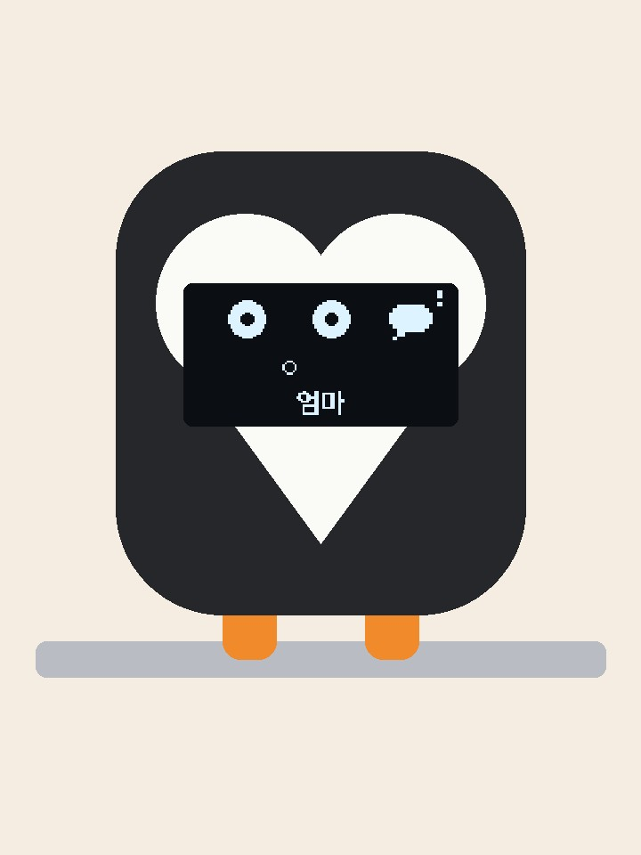
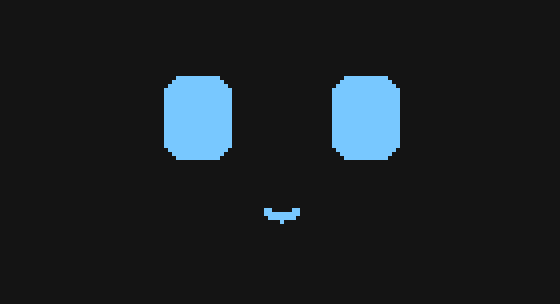

# NU87 데스크 펭귄

맥북 화면 위에 걸어 두는 작은 펭귄입니다. 평소엔 조용히 자다가, **카톡·메일이 오면 깨서 누구한테 왔는지와 내용을 보여 줘요.**
유튜브에서 듣는 노래, 날씨와 우산, 다음 일정, Claude 작업 끝, 스트레칭 알림도 띄웁니다.





```
맥 (python bridge)                                   NU87 Tiny DK ──I2C──▶ SSD1306 OLED 128×64
  알림 센터 기록 → 카톡/지메일 감지      ──USB 시리얼──▶   얼굴 그리기 · 잠/깸 · 알림 애니메이션
  한글 이름·내용·날씨 화면을 그림으로 렌더              (보드엔 한글 글꼴이 없어서 맥이 그림으로 보냄)
```

## 들어간 것

| 부품 | 역할 |
|---|---|
| NUCODE **NU87 Tiny DK** (RTL8720DF) | 얼굴·애니메이션, 맥에서 받은 그림 표시 |
| **SSD1306** 0.96" OLED 128×64 (I2C) | 얼굴 + 알림 화면 |
| 3D 프린트 케이스 3색 | [`case/`](case/) — 검정 머리·뒷판, 흰 얼굴판·뚜껑, 주황 다리 |
| (선택) TTP223 터치 | 정수리를 만지면 알림 지우기 — 터치용 STL 따로 |

전원은 노트북 USB-C 하나로 받습니다(보드에 배터리 충전 회로 없음).

## 배선

| OLED | NU87 Tiny DK |
|---|---|
| VCC | **3V3** |
| GND | 아무 GND |
| SDA | **PA26** |
| SCL | **PA25** |

터치(선택): TTP223 OUT → **PA28**. 터치가 없으면 보드의 PA27 버튼이 같은 역할을 합니다.

> OLED 가 안 뜨면 3V3 납땜부터 보세요. 이 보드는 OLED 가 없어도 `display.begin()` 이 성공으로 나와서, 시리얼 로그만 보고는 알 수 없어요.

## 펌웨어 — [`firmware/desk_pet`](firmware/desk_pet)

Arduino 보드 매니저에서 **Realtek Ameba** 코어, 라이브러리 매니저에서 **Adafruit SSD1306 / GFX** 설치 후:

```sh
cd firmware
./upload_nu87.sh desk_pet      # 처음 한 번은 BOOT 누른 채 RESET 으로 굽기 모드
```

스케치가 시리얼 `u` 를 받으면 스스로 굽기 모드로 들어가서, 두 번째부터는 버튼 없이 구워집니다.

### 시리얼 명령 (115200)

| 보내기 | 효과 |
|---|---|
| `k` / `g` | 카톡 / 메일 알림 (놀란 얼굴 + 말풍선·봉투 아이콘) |
| `n` + `k`/`g` + 256B | 보낸 사람 이름 그림(128×16)과 함께 알림 |
| `N` + `k`/`g` + 폭 2B + 512B | 긴 이름(메일 주소) 256×16 — 옆으로 흘려 보여 줌 |
| `p` + 1024B | 맥이 그린 화면 한 장(128×64)을 8초 표시 |
| `h` | 4초 동안 좋아함 (Claude 작업 끝) |
| `t` | 터치 (구석 안 읽음 아이콘 지우기) |
| `K` / `G` | 카톡 / 메일 표시만 조용히 지우기 — 맥에서 카톡 창·지메일 탭을 앞으로 띄우면 bridge 가 보냄 |
| `u` | 굽기 모드로 |

보드 수신 버퍼가 작아서 큰 데이터는 64바이트씩 20ms 간격으로 나눠 보냅니다.

## 맥 연결 프로그램 — [`bridge/`](bridge)

```sh
pip3 install -r requirements.txt
cd bridge
python3 notify_bridge.py            # 평소 모드 (Ctrl+C 로 끔)
python3 notify_bridge.py --test     # 카톡·메일 알림 한 번씩
python3 notify_bridge.py --demo     # 음악·일정·스트레칭·Claude·우산 화면 차례로
./show.sh                           # 촬영용 전체 시연 (약 1분 40초, ./show.sh loop 는 반복)
./alerts.sh                         # 촬영용 알림 장면만
```

| 파일 | 하는 일 |
|---|---|
| `notify_bridge.py` | 알림 감지 → 보드로 전송, 30분마다 날씨 |
| `features.py` | 유튜브 노래, 구글 캘린더, 스트레칭, Claude 작업 끝, 비 예보 |
| `screens.py` | 아이콘 + 한글 정보 화면, 메시지 내용 화면 |
| `name_bitmap.py` | 보낸 사람 이름을 128×16 그림으로 |
| `weather.py` | Open-Meteo 날씨 (키 필요 없음, 기본 서울) |

### 어떻게 아나

- **카톡·메일**: 맥 알림 센터 기록(`~/Library/Group Containers/group.com.apple.usernoted/db2/db`)을 1.5초마다 읽어 새 알림을 찾습니다.
  카카오톡 앱 알림, 크롬 알림 중 `mail.google.com` 에서 온 것만 씁니다. 메일 주소·제목은 열려 있는 지메일 탭 목록에서 읽어요.
  → **시스템 설정 › 개인정보 보호 및 보안 › 전체 디스크 접근 권한** 에 python3(자동 실행이면 Python.app)을 켜야 읽힙니다.
    목록에 없으면 + → Cmd+Shift+G → `/Library/Developer/CommandLineTools/Library/Frameworks/Python3.framework/Versions/3.9/Resources/Python.app`.
    Xcode 안의 Python.app 은 켜 놔도 막히는 경우가 있어서 `mac/install.sh` 는 Command Line Tools 쪽 Python 을 씁니다.
- **유튜브 노래**: 크롬 탭을 AppleScript 로 봅니다. 크롬 메뉴 **보기 › 개발자 › Apple Events의 자바스크립트 허용** 을 켜면 재생 중인지·채널·챕터까지 읽어요.
- **구글 캘린더**: 캘린더 설정의 **비공개 주소(iCal 형식)** 를 `~/.breadpet/config.json` 에 넣으면 일정 10분 전·시작할 때 알려 줍니다.
  ```json
  { "gcal_ics": "https://calendar.google.com/calendar/ical/.../basic.ics" }
  ```
- **스트레칭**: 맥을 50분 계속 쓰면 기지개 화면. 5분 이상 손을 떼면 처음부터 다시 셉니다.
- **Claude 작업 끝**: [`mac/claude-hooks.json`](mac/claude-hooks.json) 의 훅을 Claude Code 설정(`~/.claude/settings.json`)에 합치면, 2분 넘게 걸린 작업이 끝날 때 체크 화면 + 좋아하는 얼굴.
- **내용 숨기기**: 옆자리에 메시지가 보이는 게 싫으면 config 에 `"show_content": false`.

### 로그인할 때 자동 실행

```sh
mac/install.sh        # 등록 (로그: ~/.breadpet/bridge.log)
mac/install.sh off    # 해제
```

`upload_nu87.sh`·`show.sh` 는 시리얼 포트를 쓰려고 자동 실행을 잠깐 멈췄다가 끝나면 다시 켭니다.

## 케이스 — [`case/`](case/)

`clip_v6.py` (build123d) 로 만들었고, 바로 뽑을 STL 은 [`case/stl/`](case/stl):

| 파일 | 색 | 설명 |
|---|---|---|
| `1_white_face.stl` | 흰색 | 하트 얼굴판 — 머리 앞 홈에 접착 |
| `1_white_cover.stl` | 흰색 | 보드 주머니 뚜껑 (버튼·LED 구멍) |
| `2_black_head.stl` | 검정 | 머리 — OLED 자리 |
| `2_black_back.stl` | 검정 | 뒷판 + 노트북 걸이 + 보드 주머니, 점퍼선 빠지는 구멍 |
| `3_orange_legs.stl` | 주황 | 화면 앞에 대롱대롱 다리 — 1.75mm 필라멘트 조각을 다월로 끼워 접착 (나사 없음) |
| `touch/` | 검정 | 정수리에 TTP223 자리가 있는 머리·뒷판 |

단색 프린터 기준으로 색마다 따로 뽑아 붙입니다. 보드는 노트북 덮개 뒤 주머니에 세로로 들어가고 USB-C 가 아래를 향해요.

```sh
python clip_v6.py              # 기본
TOUCH=1 python clip_v6.py      # 터치 자리 있는 버전
```

## 화면 미리보기

보드 없이 알림 애니메이션을 GIF 로 봅니다: `python3 sim/notify_preview.py`
